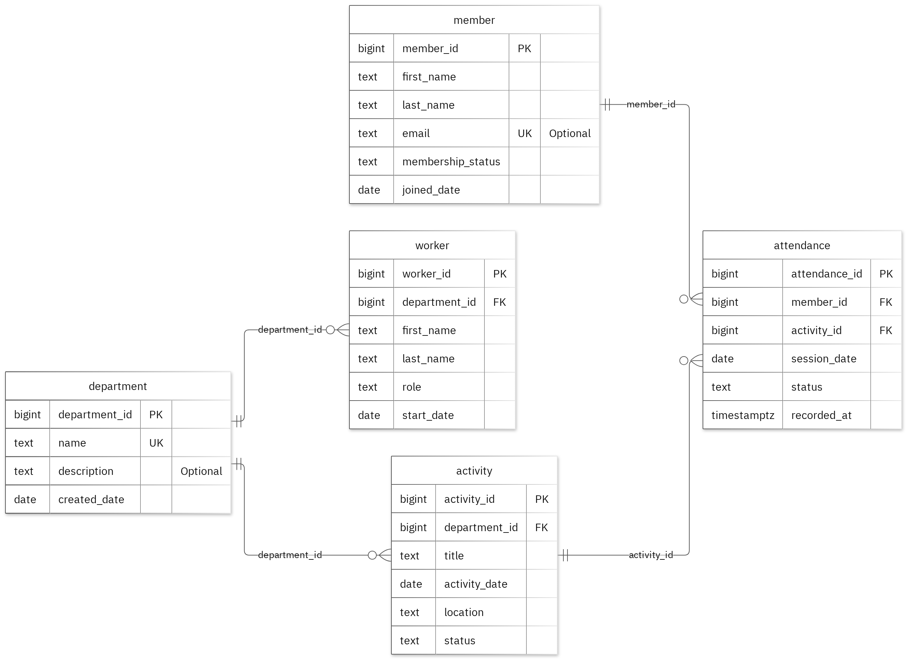

# Church Management System Database Exercise

Glory Arogundade · Student ID 301908292 · MIT 8103 Advanced Database Systems

## Overview

We were allowed to choose our own case study for this assignment, and I decided to work with a
Church Management System Database. The idea came from the need to have a better way of keeping
track of church records, especially members, workers, departments and activities. The database is
designed for church administrators who handle member and department records, activity coordinators
who plan programmes and monitor attendance, and workers who support the day-to-day activities of
the church.

I created five tables, connected so that the database can register members, assign workers to a
department, schedule departmental activities and record attendance. It can also be used to check
attendance for a particular activity, date or department.

| Table | Holds |
| --- | --- |
| `department` | The departments of the church |
| `member` | People registered as members |
| `worker` | Members serving in a department |
| `activity` | Programmes scheduled by a department |
| `attendance` | Who attended which activity, and their status |

Each table has a primary key, foreign keys maintain the relationships, and check constraints
enforce the business rules — for example, attendance status is restricted to Present, Absent or
Excused.

## Portfolio index

| # | Activity | What it covers |
| --- | --- | --- |
| 1 | [Database Design and Modelling](portfolio-1-database-design/) | The five tables, keys and constraints, the ER diagram, normalisation to 1NF, 2NF and 3NF, and 14 invalid inserts that were all rejected |
| 2 | [Query Processing and Optimisation](portfolio-2-query-optimisation/) | SQL queries against the sample records, including a JOIN across tables, and an index comparison on a separate set of 20,000 records |
| 3 | [Transactions and Concurrency](portfolio-3-transactions-concurrency/) | COMMIT, ROLLBACK and READ COMMITTED isolation, and two sessions updating the same record with and without `SELECT FOR UPDATE` |
| 4 | [NoSQL and Advanced Data Models](portfolio-4-nosql/) | The `church_activity_events` collection in MongoDB, embedded snapshots, and validation rules tested against invalid documents |
| 5 | [Distributed and Cloud Database Exercise](portfolio-5-distributed-cloud/) | A proposed three-member replica set across separate availability zones, primary elections, majority acknowledgement and sharding — the permitted discussion option |

Each folder has its own README with the explanation, the scripts and the screenshots for that
activity.

## Results

- The 14 invalid inserts were rejected at their expected constraints, and the valid sample rows
  were unchanged.
- The median lookup time fell from 0.941 ms to 0.167 ms once the index was added. Both runs
  returned the same records and the execution plan confirmed the index was used. These figures are
  for the particular lookup and test environment I used.
- Without locking, two concurrent increments left the counter at 2 instead of 3. With
  `SELECT FOR UPDATE`, session B waited for session A and the counter was correctly recorded as 3.
- MongoDB inserted 2 sample events and ran 4 queries, all returning the expected results. An
  invalid date format and a duplicate event ID were both rejected.

## Tools

PostgreSQL for the relational work, MongoDB for the document model, and Mermaid for the ER diagram.
PostgreSQL remains responsible for enforcing the relational rules; the MongoDB collection stores
event history alongside it rather than replacing it.

## Final summary

The full write-up, including the individual reflection, the AI-use declaration and the references:

[Final summary](Arogundade_Glory_301908292_FinalSummary.md) · [PDF](Arogundade_Glory_301908292_FinalSummary.pdf)

## Note on the data

The church, its members and its activities are fictional, and all records in this repository are
synthetic. No real congregation's records are used anywhere.
