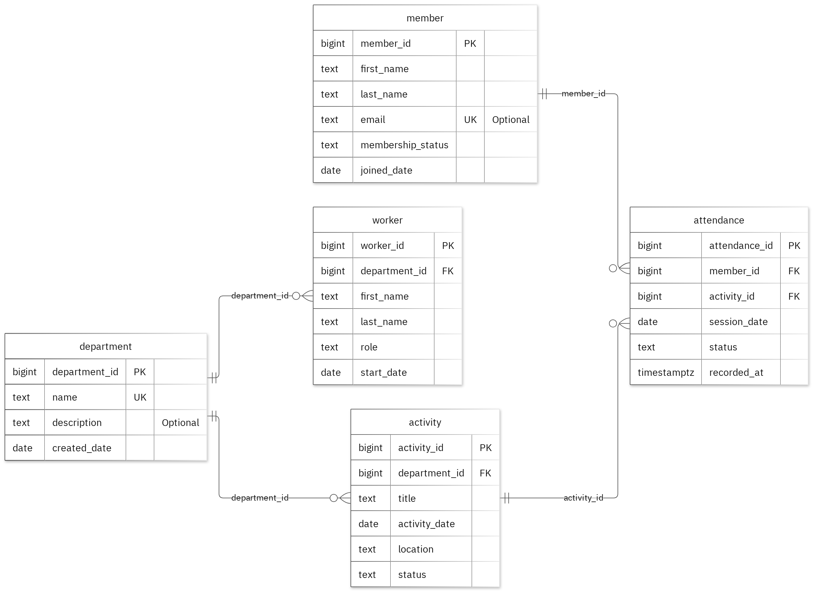

# MIT 8103 Advanced Database Systems

**Church Management System Database Exercise** · Glory Arogundade · Student ID 301908292

## Case study

As part of this assignment I have designed my own case study to show my understanding. I choose a Church Management System Database as this is something I’ve been thinking about. This database allows for an improved way of managing records for church Members, Workers, Departments and Activities. It will be used by the Administrators to look at Member, Department, Activity Coordinators to plan programme and track attendance, and Workers.

I created 5 tables which are Department, Member, Worker, Activity, and Attendance. This helps with adding new members, assigning Workers to a department, planning activities for each department, and keeping track of attendance. This database can be used to look up attendance for specific activities, dates and departments.

## Portfolio 1: Database Design and Modelling

I created 5 tables with links between them. Each table has a primary key to make sure there are no duplicates and foreign keys to make sure the relationships between tables are maintained. There are also checks within the database to make sure certain rules are followed such as attendance being set to Present, Absent or Excused.

I also used test data to show how the data can be designed to be in 1NF, 2NF and 3NF. I tried to add 14 incorrect records to the database but they were all refused so the correct data remained.

Figure 1. Tables, keys and relationships. PK: primary key; FK: foreign key; UK: unique value.

<!-- PAGE BREAK -->

## Portfolio 2: Query Processing and Optimisation

I created 3 SQL queries. One of them used a JOIN statement to return related data. This returned 1 record showing Alex attended the community gathering.

I also created a test with 20,000 records of a different set of data. Adding an index decreased the Median time to 0.167 from 0.941. The same data was shown and the Execution Plan showed that the new index was being used.

## Portfolio 3: Transactions and Concurrency

I created a temporary count column in the attendance table. I tested using Commit, Rollback and Read Committed. When trying to update the data with the uncommitted transaction it was not visible in the other session. When using Rollback it rolled back to the previous count.

I also tried to update the same record in 2 sessions. Without any locks in place both sessions increased the count so it was 2 instead of 3. Using SELECT FOR UPDATE meant session B had to wait for session A to complete its changes. This meant the count was correct as it was 3. The count was temporary and did not effect any of the real business columns.

## Portfolio 4: NoSQL and Advanced Data Models

I used the church_activity_events table to store data relating to events in the church management system. I added 2 sample events to MongoDB. 4 queries were run which all returned the correct data.

I tested adding some validation rules. Adding an event with an incorrect date format and duplicate event ID was refused. I showed how related data can be stored in an event using embedded snapshots. The details column can also include different types of data depending on the event. The events used were fictional but the original rules from the relational database were still enforced by PostgreSQL.

## Repository and evidence

https://github.com/RubydDesigner/Arogundade_Glory_301908292

The portfolios contain the SQL, JavaScript, explanations, query plans, result tables and screenshots.

<!-- PAGE BREAK -->

## Portfolio 5: Distributed and Cloud Database Exercise

I discussed how I would improve the reliability of the church database by having 3 replica members in MongoDB. I explained how primary elections take place, majority acknowledgement, how long it takes for the secondaries to update, and the advantages and disadvantages of sharding the church_activity_events collection.

Having replicas will make sure the database is available if one member fails. Backups will still need to be done to recover any data that has been lost. PostgreSQL will also need its own plan for availability and recovery. As a result I did not actually create a replica set or test live failover. This was the option I was able to discuss.

## Personal reflection

Throughout this project I realised how important it is to store related data correctly. I created 5 tables for Department, Member, Worker, Activity and Attendance to make sure there was no duplication of data. Rules were added to make sure attendance can only be set to Present, Absent or Excused. I also tested the database to make sure the rules and relationships were working.

When completing the 2 sessions exercise I learnt how easy it is for data to be affected when 2 users are trying to update the same data. Both sessions had the same starting value which caused issues with the final value. Using row locks helped stop this from happening and made sure both updates were recorded correctly.

The index comparison helped me realise how important it is to think about how the database is retrieving the data and if it is doing it efficiently even though getting the correct result is important.

## AI-use declaration

GitHub Copilot and the portfolio generator were used to help create the database model and scripts. The generator ran through the PostgreSQL and MongoDB exercises, checked the results, and took screenshots. I am responsible for ensuring the work is checked and explained.

## References

- [PostgreSQL: constraints](https://www.postgresql.org/docs/17/ddl-constraints.html)
- [PostgreSQL: EXPLAIN](https://www.postgresql.org/docs/17/using-explain.html)
- [PostgreSQL: isolation](https://www.postgresql.org/docs/17/transaction-iso.html)
- [PostgreSQL: row locks](https://www.postgresql.org/docs/17/explicit-locking.html)
- [MongoDB: data modelling](https://www.mongodb.com/docs/manual/data-modeling/)
- [MongoDB: replication](https://www.mongodb.com/docs/manual/replication/)
- [MongoDB: sharding](https://www.mongodb.com/docs/manual/sharding/)
- [Mermaid: ER diagrams](https://mermaid.js.org/syntax/entityRelationshipDiagram.html)

